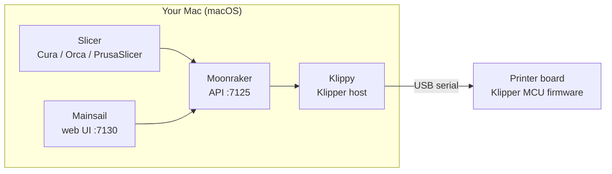

<h1 align="center">klipper-macos</h1>

<p align="center">
  <b>Use your Mac as the Klipper host for your 3D printer.</b><br>
  Klipper, Moonraker and Mainsail running natively on macOS: no Raspberry Pi, no VM, no Docker.
</p>

<p align="center">
  
  
  
  
</p>

---

## What this is

[Klipper](https://www.klipper3d.org/) is a 3D printer firmware that splits the work in two: a small firmware on the printer's board, and a **host program** on a real computer that does the heavy math (motion planning, input shaping, pressure advance, macros). Normally that computer is a Raspberry Pi running Linux.

**This project makes your Mac that computer.** You plug the printer into the Mac with its USB cable, run one installer, and get the full Klipper stack with the Mainsail web interface at `http://127.0.0.1:7130`.



### Who it's for

- You have a printer that Klipper supports, and a Mac that sits on the desk anyway.
- You want Klipper's features (input shaping, pressure advance, macros, a web UI) **without buying a Raspberry Pi**, or before buying one.
- You're fine with the Mac staying on and awake while it prints (see [macOS gotchas](#macos-gotchas-read-these)).

If you want a printer that runs on its own with the Mac switched off, a Raspberry Pi with [MainsailOS](https://github.com/mainsail-crew/MainsailOS) or [KIAUH](https://github.com/dw-0/kiauh) is still the better choice.

### Why it didn't exist

Klipper only supports Linux officially, and Docker on macOS can't pass a USB serial port into a container. It turns out that the only real obstacles are a few Linux-only system calls. This project patches those (about 20 lines in total), installs everything, and runs it as macOS background services.

## Quick start

Requirements: [Homebrew](https://brew.sh), Xcode Command Line Tools (`xcode-select --install`), and a printer board that runs (or can be flashed with) Klipper firmware.

```
git clone https://github.com/guastallastudio-creator/klipper-macos.git
cd klipper-macos
./install.sh
```

Then open http://127.0.0.1:7130, [flash the firmware](#flash-the-firmware) if your board doesn't run Klipper yet, and [set your serial port](#configure-the-printer).

## Status

Tested and used for real prints, including multi-hour ones, on:

| | |
|---|---|
| Mac | Apple Silicon MacBook, macOS 26 |
| Printer | Anycubic i3 Mega S (ATmega2560 board, USB serial at 250000 baud) |
| Klipper | `461c4e3` |
| Moonraker | `9e676eb` |
| Mainsail | v2.19.0 |

So far it has been tested with one printer. If you try it on a different board or Mac, please open an issue and say whether it worked.

## What the installer does

1. Installs `python@3.12` and `libsodium` with Homebrew.
2. Clones Klipper, Moonraker and mainsail-config at the tested commits and applies the patches in `patches/`.
3. Creates two Python virtual environments and compiles Klipper's C helper with clang.
4. Downloads the Mainsail web UI.
5. Creates `~/printer_data` (config, logs, gcodes) with a macOS-ready `moonraker.conf`.
6. Installs 4 launchd services (`com.klipper-macos.*`) that start when you log in:

| Service | What it runs |
|---|---|
| `klipper` | Klippy, the Klipper host |
| `moonraker` | Moonraker API on `127.0.0.1:7125` |
| `mainsail` | Mainsail web UI on `127.0.0.1:7130` |
| `helper` | keeps the Mac awake while printing, and indexes new G-code files |

It also installs the `klipper-mac` command:

```
klipper-mac status     # services, Klipper state, temperatures
klipper-mac stop       # stop everything and free the USB port
klipper-mac start
klipper-mac restart    # restart Klipper after editing printer.cfg
klipper-mac open       # open Mainsail in the browser
klipper-mac log [n]    # last lines of klippy.log
```

Options: `./install.sh --help`. Ports and folders can be changed with environment variables, for example `MOONRAKER_PORT=7126 MAINSAIL_PORT=7131 ./install.sh`.

## Flash the firmware

Your printer board needs Klipper's firmware. You can build it on the Mac too. For AVR boards (ATmega2560, which the tested printer uses):

```
brew tap osx-cross/avr
brew install avr-gcc@14 avrdude
cd ~/klipper
make menuconfig          # pick your MCU, clock and baud rate (see the top of your printer's example config)
PATH="$(brew --prefix avr-gcc@14)/bin:$PATH" make
klipper-mac stop         # free the serial port
avrdude -c wiring -p m2560 -P /dev/cu.usbserial-XXXX -b 115200 -D -U flash:w:out/klipper.elf.hex:i
```

`readelf: command not found` during `make` is harmless: macOS has no `readelf`, and the build still finishes. **Before flashing, back up your current firmware or have its `.hex` at hand**, so you can go back.

ARM boards (STM32 and similar) need the `arm-none-eabi` toolchain. That path is untested so far; pull requests are welcome.

## Configure the printer

Edit `~/printer_data/config/printer.cfg`. Start from your printer's example in `~/klipper/config/`. The main difference on macOS is the serial port:

```
[mcu]
serial: /dev/cu.usbserial-XXXX     # find it with: ls /dev/cu.*
```

Use `/dev/cu.*`, not `/dev/tty.*`. `/dev/serial/by-id/` doesn't exist on macOS.

Then run `klipper-mac restart`.

### Slicers

- **Save to `~/printer_data/gcodes`**. The helper picks up new files within about 15 seconds, and Mainsail shows them with time and filament estimates.
- **Or upload directly**: Moonraker emulates OctoPrint. In PrusaSlicer/OrcaSlicer add a physical printer of type OctoPrint at `http://127.0.0.1:7125`. In Cura, use the OctoPrint Connection plugin.

## macOS gotchas (read these)

- **Nothing else may open the printer's serial port.** On many boards, opening the port resets the board, which kills a running print. Disable Cura's "USB printing" plugin, and close Pronterface, the Arduino IDE and similar tools. Run `klipper-mac stop` when you need the port for something else.
- **The Mac is the printer's brain now.** If it sleeps, the print stops. The helper prevents idle sleep while a print is running, but closing the lid on battery will still put the Mac to sleep. Keep the lid open and the charger connected for long prints.
- **Localhost only.** Everything listens on `127.0.0.1`, and Moonraker trusts local clients without a password. If you want to reach Mainsail from your phone, use a VPN such as Tailscale or an SSH tunnel instead of opening the ports to your network.
- **No update manager.** Moonraker's update manager depends on systemd. To update, `git pull` the repos and run `./install.sh` again.
- **Harmless log lines.** Moonraker logs that libcamera, `vcgencmd` and D-Bus are unavailable. Those are Raspberry Pi and Linux features.

## The patches

| File | Why |
|---|---|
| `klippy/chelper/pyhelper.c` | `prctl()` is Linux-only, so `pthread_setname_np()` is used to name threads |
| `klippy/chelper/serialqueue.c` | `<linux/can.h>` doesn't exist. A minimal `struct can_frame` lets it compile (CAN bus is not supported on macOS) |
| `moonraker/components/proc_stats.py` | `CLOCK_BOOTTIME` doesn't exist, so it falls back to `CLOCK_MONOTONIC` |
| `moonraker/utils/__init__.py` | `SO_PEERCRED` doesn't exist. It is skipped, because it is only used by the systemd integration |

Moonraker also gets `file_system_observer: none` (there is no inotify) and `provider: none` (there is no systemd), plus a stub `ip` command in `~/printer_data/bin`.

## FAQ

**Does the Mac have to stay on during a print?**
Yes. Klippy on the Mac sends every move to the board in real time. If the Mac sleeps or shuts down, the print stops.

**Intel Macs? Older macOS?**
Probably, but untested. The installer only uses Homebrew, Python 3.12 and clang. If you try it, please open an issue with the result.

**Can I go back to my old firmware?**
Yes: flash your backup `.hex` (or the stock firmware from the manufacturer) with the same `avrdude` command, and run `./uninstall.sh`.

**Why not Docker or a Linux VM?**
Docker Desktop on macOS can't pass USB serial devices into containers. A Linux VM can work, but it means USB passthrough plus a whole second operating system to keep updated. Running natively avoids both.

## Uninstall

```
./uninstall.sh
```

This removes the services and the `klipper-mac` command. Your config, G-code files and the downloaded sources stay, and the script prints which folders to delete if you want them gone.

## Contributing

The most useful thing right now is **test reports**: open an issue with your Mac, macOS version, printer and board, and whether it worked. Fixes for other boards (ARM/STM32 flashing, other serial adapters) are very welcome as pull requests.

## Credits and license

All the real work is [Klipper](https://github.com/Klipper3d/klipper), [Moonraker](https://github.com/Arksine/moonraker) and [Mainsail](https://github.com/mainsail-crew/mainsail). This project only adapts them to macOS and is not affiliated with them.

GPL-3.0, like Klipper and Moonraker.
